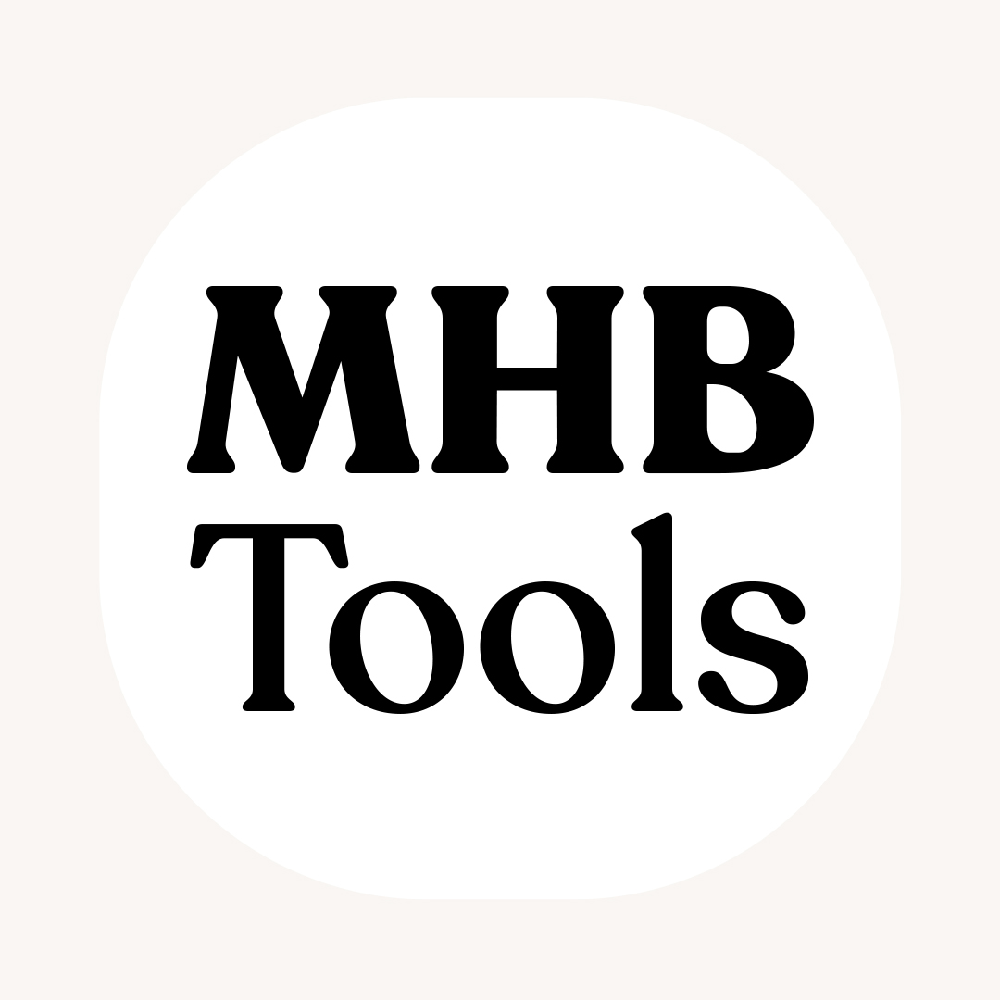

# mpv-persian

  

<h1 align="center">MPV Persian Config | MHB Tools</h1>

  پروفایل بهینه‌شده و شخصی‌سازی‌شده MPV Player جهت تماشای فیلم و گوش دادن به موسیقی.

---

## ✨ امکانات
- **زیرنویس تمیز:** پس‌زمینه نیمه‌شفاف مشکی (بدون استروک اضافه) با فونت مناسب فارسی و تنظیم موقعیت بالاتر.
- **شورتکات‌های اختصاصی:** تغییر سرعت با `Z` (بازگشت به سرعت قبلی)، تغییر زبان صدا با `Ctrl+D` و تغییر زیرنویس با `Ctrl+S`.
- **توقف با مینیمایز:** با زدن کلید `B` (یا مینیمایز کردن)، ویدیو متوقف شده و با برگشت، ادامه پیدا می‌کند.
- **صدای بهینه:** شروع پخش با صدای ۲۰ درصد برای جلوگیری از صدای ناگهانی و ترکیدن صدا.
- **کیفیت تصویر:** استفاده از موتور رندر `gpu-next` و پخش سخت‌افزاری (`hwdec`).

## 🚀 نحوه نصب
1. فایل MPV را از [سایت رسمی](https://mpv.io) یا [نسخه‌های ویندوز](https://github.com/zhongfly/mpv-winbuild/releases) دانلود کنید.
2. پوشه `portable_config` را از این مخزن دانلود کرده و **دقیقاً کنار فایل `mpv.exe`** قرار دهید.
3. **نکته مهم:** برای نمایش درست زیرنویس‌ها، فونت [Vazirmatn](https://github.com/rastikerdar/vazirmatn) را روی سیستم خود نصب کنید.

## ⌨️ شورتکات‌های کلیدی
| کلید | عملکرد |
| :--- | :--- |
| `c` / `x` | افزایش / کاهش سرعت پخش |
| `z` | برگشت به حالت عادی / سرعت قبلی |
| `Ctrl + d` | تغییر زبان صدا (Audio Track) |
| `Ctrl + s` | تغییر زبان زیرنویس (Subtitle Track) |
| `Ctrl + m` | گرفتن اسکرین‌شات |
| `h` / `g` | افزایش / کاهش تاخیر زیرنویس (Sub Delay) |
| `b` | مینیمایز کردن و توقف ویدیو |
| `Ctrl + c` | بستن کامل برنامه |
| `f` | کوچک و بزرگ‌کردن پخش‌کننده |

نکته: باید زبان روی حالت انگلیسی باشه تا عمل کنه
---
**ساخته شده توسط [MHBTools](https://github.com/MHBTools)**
